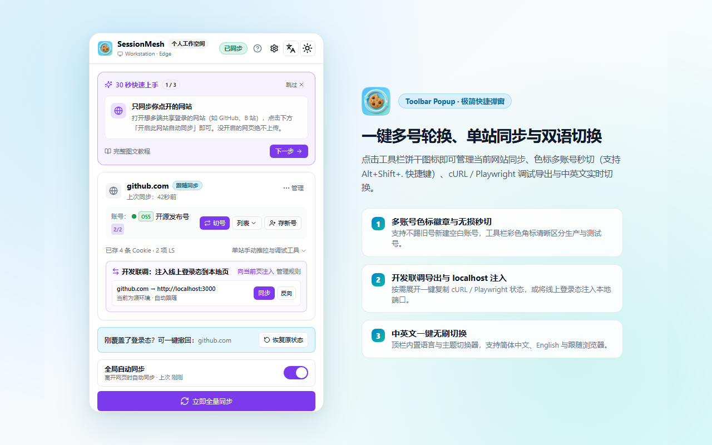
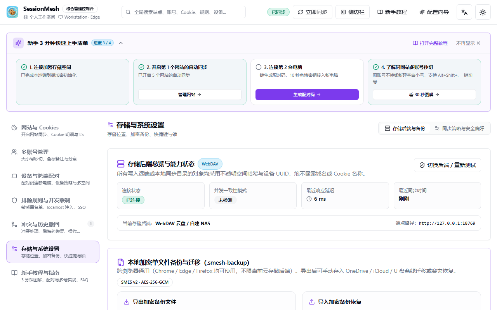
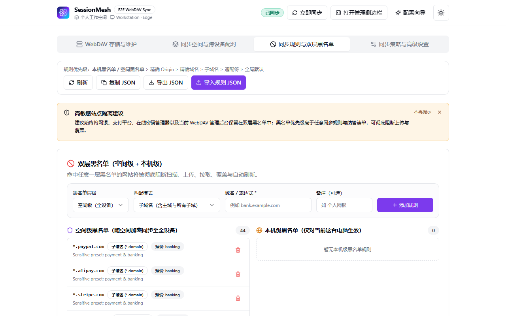

<div align="center">
  
  <h1>SessionMesh</h1>
  <p>Multi-device browser login state auto-sync over WebDAV with client-side E2E encryption.</p>

  <p>
    <a href="https://github.com/fxwl/screenshots/actions/workflows/build-zip.yml">
      
    </a>
    
    
    
    
    
  </p>

  <p><strong>English</strong> | <a href="./README_ZH.md">简体中文</a></p>
</div>

---

**SessionMesh** is an open-source browser extension for **Microsoft Edge** (and Chromium-based browsers) that keeps your website login sessions — **Cookies** and origin-scoped **`localStorage`** — synchronized across your devices using **your own WebDAV server**. All payloads are encrypted locally in the browser before upload, with zero developer servers and zero tracking.

## Features

- **Zero-Knowledge E2E Encryption (SMES v2)**: Encrypts payloads locally via Web Crypto (`AES-256-GCM` with authenticated header/path AAD, `PBKDF2-SHA256` 200,000 iterations, and per-file `HKDF-SHA256` keys).
- **Local Key Protection**: Master passwords are never saved in plaintext. Space keys are wrapped by a non-extractable `AES-256-GCM` key (`extractable: false`), with an optional **Session Lock** mode that clears keys when the browser closes.
- **Bring Your Own WebDAV**: Works with Nextcloud, Jianguoyun (Nutstore), Synology NAS, Caddy, Nginx, Alist, or any standard WebDAV endpoint (Basic Auth, App Password, or Bearer Token) with a built-in **19-step capability & CAS consistency detector** and HTTP `507` storage-full circuit breaker.
- **Managed Sites, Authority Policies & Dual-Layer Blacklist**: Sync only opted-in domains (`managed_only`), configure space authority modes (`ask`, `primary_device`, `latest_wins`) and per-device roles (`pull_only`, `push_only`, independent tracks), protected by space-wide + device-only blacklists and SSO domain groups.
- **Smart Sync Timing & High-Reliability Engine**: Supports **`on_page_leave`** (quietly compacts changes while a tab is open and flushes on leave) alongside real-time/periodic sync, exact colliding-cookie disambiguation (`hostOnly` vs wildcard domain & sibling paths), mandatory browser readback verification, startup reconciliation, and `>256KB` SPA `localStorage` blob guards.
- **Multi-Account Tracks & 10-Second Pairing**: Maintain separate account tracks per site, isolate work/personal spaces, and pair new devices via encrypted `smesh://pair/...` pairing codes.
- **Safe Auto-Refresh & Anti-Loop Shields**: Detects active form input, `contenteditable` edits, or pending file uploads before reloading tabs, and blocks reload loops across `localStorage`-only updates and background polls.
- **Side Panel & Full Console**: Inspect, edit, import/export Cookies and `localStorage`, resolve conflicts, restore history snapshots, and run WebDAV AEAD integrity checks, backups & safe GC.

## Installation

### Official Store & Pre-built Releases (Recommended)

- **Microsoft Edge Add-ons**: *Under review*
- **GitHub Releases (Auto-built on every push)**: [Download latest `.zip`](https://github.com/fxwl/screenshots/releases) → unzip → load unpacked in `edge://extensions` (also compatible with other Chromium-based browsers via manual unpacked install).

### Build from Source

Prerequisites: **Node.js >= 20.12** and **pnpm 9+**.

```bash
# 1. Install dependencies
pnpm install

# 2. Build the extension (outputs to dist/)
pnpm build

# 3. (Optional) Create an uploadable store zip (outputs to dist-zip/)
pnpm zip
```

Then load the unpacked extension in Microsoft Edge (or another Chromium-based browser):

1. Open `edge://extensions`.
2. Enable **Developer mode**.
3. Click **Load unpacked** and select the `dist/` directory.

## Quick Start

### Step 1: Connect Your WebDAV Server

After installation, the Onboarding Wizard opens automatically. Enter your HTTPS WebDAV endpoint (presets provided for Jianguoyun, Nextcloud, Synology NAS, and Alist) and credentials, then click **Test Connection** to run the 19-step capability & consistency check.

<p align="center">
  
</p>

### Step 2: Create or Join an Encrypted Sync Space

Create a new space on Device A (or auto-detect and join an existing space on Device B/C), name your device, and set a strong **Master Encryption Password** (separate from your WebDAV password; never leaves your browser).

<p align="center">
  
</p>

### Step 3: Manage & Sync Websites via Popup or Side Panel

Add websites to your managed list from the wizard, toolbar **Popup**, **Side Panel**, or right-click **Context Menu**. Click the toolbar icon anytime for quick per-site Push/Pull, track splitting, or one-click full sync.

<p align="center">
  
</p>

### Step 4: Pair Additional Devices in 10 Seconds

Open **Options → Spaces & Pairing**, generate an encrypted `smesh://pair/...` pairing code protected by a one-time passphrase, and paste it into Step 1 on your other browser to fill WebDAV & space settings automatically.

<p align="center">
  
</p>

## Interface Showcase

### Side Panel — Cookie Readback Verification & `localStorage` Manager

Inspect individual cookies (with `HttpOnly` / `Secure` / `SameSite` flags and readback verification status), switch or isolate multi-account tracks, and manage origin-scoped `localStorage` items.

<p align="center">
  
</p>

### Control Center — WebDAV Diagnostics, Snapshots & Backups

View real-time connection status, CAS consistency level (`Strong CAS` vs `Append-Only`), latency, AEAD data integrity verification, encrypted snapshots, and safe garbage collection.

<p align="center">
  
</p>

### Control Center — Sync Rules & Dual-Layer Blacklist

Configure space-wide and device-only blacklists (higher priority than any sync rule), preset banking/password-manager exclusions, SSO domain groups, and JSON rule import/export.

<p align="center">
  
</p>

### Control Center — Primary Device Authority & Per-Device Policies

Switch between `managed_only` and `all_sites`, designate a primary authority device (`ask`, `primary_device`, `latest_wins`), configure per-device direction/exclusions, and tune sync timing (`on_page_leave` vs real-time).

<p align="center">
  
</p>

## Troubleshooting & Testing Notes

Common issues encountered during real-world WebDAV & Chromium MV3 testing and how SessionMesh handles them:

- **HTTP WebDAV URL rejected (`HTTPS is required`)**:
  - Production WebDAV endpoints must use `https://`.
  - When testing locally with `node scripts/start-local-webdav.mjs` (`http://127.0.0.1:8765`), explicitly enable the **"Allow local loopback HTTP testing"** toggle that appears in Step 1.
- **HTTP `401 Unauthorized` on Jianguoyun (坚果云) or Nextcloud**:
  - Do **not** use your regular account password. Generate a dedicated **App Password** in your provider's security settings and select `App Password` / `Basic` authentication.
- **HTTP `403` / `405` / `501` during `OPTIONS` probe**:
  - Some servers or reverse proxies (e.g., Cloudflare WAF, IIS, Synology reverse proxy, Nutstore) restrict `OPTIONS` while supporting `PROPFIND`/`PUT`/`GET`. SessionMesh automatically falls back to `PROPFIND` verification — expand the 19-step capability report in **Options → WebDAV** to inspect details.
- **Strong CAS vs. Append-Only Degraded Mode**:
  - If your WebDAV server ignores conditional headers (`If-Match` / `ETag`), the 19-step detector reports `Append-Only Degraded` mode rather than risking silent overwrites. Sync remains fully functional, and periodic snapshots/GC keep storage tidy.
- **HTTP `507 Insufficient Storage` (WebDAV quota full)**:
  - SessionMesh activates a `storageFullHalted` circuit breaker to stop background retry storms. Free up space or run GC on your WebDAV server, then click **Sync Now** once to resume.
- **`localStorage` shows `Cached (waiting for page context)` or skips `>256KB` blobs**:
  - Browser security rules only allow writing `window.localStorage` when a tab on that exact origin is open; incoming items are cached locally and applied automatically when you visit the site. Oversized (`>256KB`) SPA state blobs are skipped to avoid polluting WebDAV storage, and reserved keys (`__proto__`, `constructor`, etc.) are handled safely.
- **Special & Colliding Cookies (`__Host-`, `__Secure-`, `SameSite=None`, `hostOnly` vs `.domain`, `partitionKey`)**:
  - Chromium enforces strict prefix rules and can host colliding same-name cookies across `hostOnly`, wildcard `.domain`, and sibling paths (`/admin` vs `/`). SessionMesh normalizes browser default cookie store IDs (`"0"` / `"firefox-default"` → `"default"`), disambiguates exact cookie identities on readback and deletion, falls back gracefully if an older browser rejects `partitionKey`, and exposes per-cookie retry in the Side Panel.
- **Changes not uploading immediately while a tab is still open**:
  - By default, SessionMesh uses **`on_page_leave`** timing to compact noisy edits quietly while you browse and upload cleanly when you leave/switch away from the page (or click **Sync Now** anytime). You can switch to real-time sync in **Options → Sync Policy**.
- **Tab did not auto-reload after pulling a session**:
  - Multi-layer **Safe Reload Guard** & anti-reload-loop shields defer auto-refresh if you have unsaved form input, active typing (15s grace window), `contenteditable` edits, or pending file uploads, and never loop on `localStorage`-only updates. Refresh manually anytime.
- **Forgot Master Encryption Password or Session Lock active**:
  - With **Session Lock** enabled, local keys are wiped when the browser closes — re-enter your Master Password to resume syncing. Because encryption is strictly zero-knowledge, a forgotten Master Password cannot be recovered; rotate credentials from an unlocked device or initialize a new space.

## Development

```bash
pnpm dev            # Watch mode for extension & UI pages
pnpm lint           # ESLint + Prettier check across workspace
pnpm type-check     # TypeScript check across all workspace packages
pnpm test           # Run all 132 Vitest unit & acceptance tests
pnpm clean          # Clean dist/ and .turbo caches safely
pnpm build          # Production build -> dist/
pnpm zip            # Production build + store zip -> dist-zip/
```

For local WebDAV testing without an external server, run the built-in mock server:

```bash
node scripts/start-local-webdav.mjs
```

See [CONTRIBUTING.md](./CONTRIBUTING.md) for contributor guidelines and [CHANGELOG.md](./CHANGELOG.md) for release notes.

## Project Structure

```text
.
├── chrome-extension/     # MV3 manifest, background service worker, locales & icons
├── pages/
│   ├── popup/            # Toolbar popup for quick status & current-site actions
│   ├── sidepanel/        # Side panel for site tracks, cookies & localStorage inspection
│   ├── options/          # Full management console (WebDAV, spaces, rules, policies, backups)
│   └── content/          # Isolated content script (localStorage sync & safe reload guard)
├── packages/
│   ├── core/             # Sync engine, SMES v2 crypto, WebDAV client, causal versioning & rules
│   ├── storage/          # IndexedDB persistence, non-extractable key vault & chrome.storage helpers
│   ├── shared/           # Shared IPC protocol, React hooks & utilities
│   ├── ui/               # Shared Tailwind / Radix UI components
│   ├── webdav-mock/      # In-memory WebDAV server for automated & local testing
│   ├── zipper/           # Release archive builder (dist/ -> dist-zip/)
│   └── ...               # Dev/build tooling (hmr, dev-utils, tsconfig, tailwind-config)
├── docs/screenshots/     # Product screenshots (1280x800 24-bit PNG)
└── scripts/              # Local development helper scripts
```

## Privacy & Security

SessionMesh operates strictly between your browser and your own WebDAV server. It collects no personal data, includes no analytics/telemetry, and executes no remote code.

- Privacy Policy & Permission Disclosures: [PRIVACY.md](./PRIVACY.md)
- Security Architecture & Vulnerability Reporting: [SECURITY.md](./SECURITY.md)

## License

[MIT](./LICENSE)
