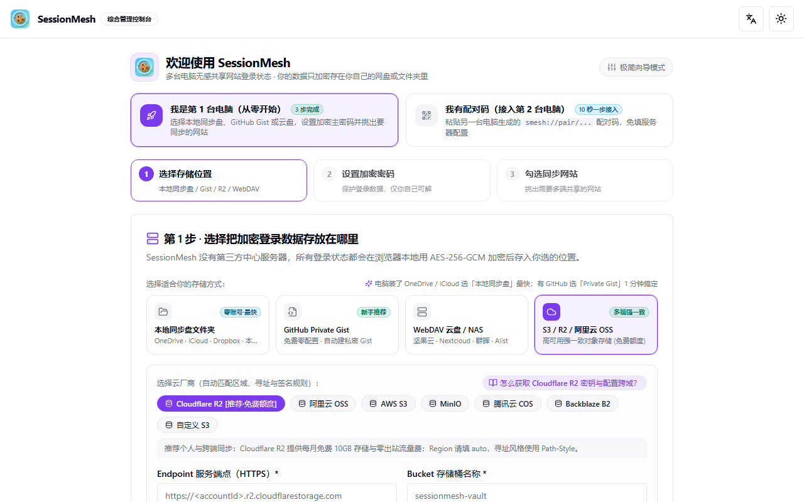
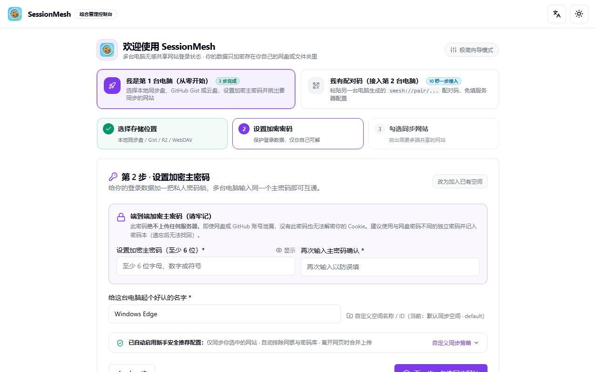
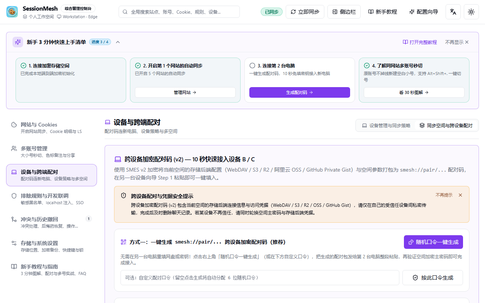
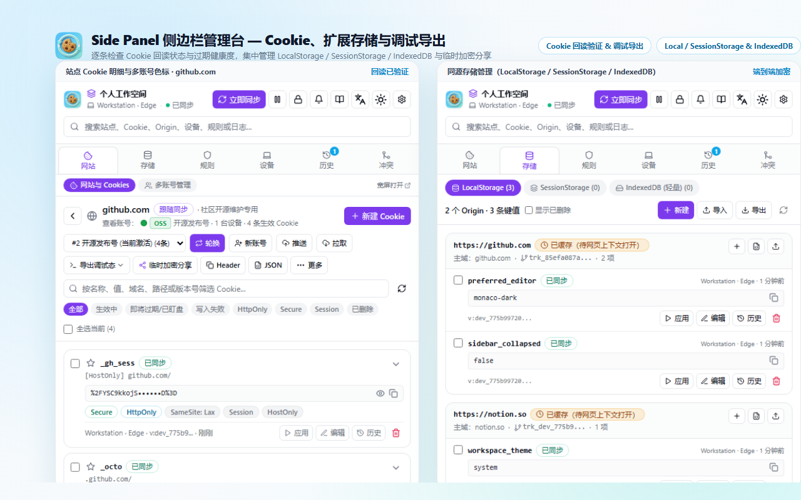
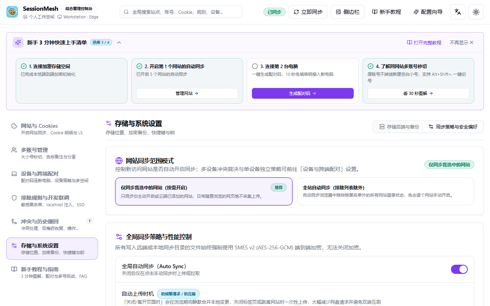

<div align="center">
  
  <h1>SessionMesh</h1>
  <p>Multi-device browser login state auto-sync across WebDAV, S3/R2/OSS, GitHub Private Gist &amp; local sync folders with client-side E2E encryption.</p>

  <p>
    <a href="https://microsoftedge.microsoft.com/addons/detail/lciamlghddinjagggaocchcoifncbnak">
      
    </a>
    <a href="https://github.com/fxwl/screenshots/actions/workflows/build-zip.yml">
      
    </a>
    
    
    
    
    
  </p>

  <p><strong>English</strong> | <a href="./README_ZH.md">简体中文</a></p>
</div>

---

**SessionMesh** is an open-source browser extension for **Microsoft Edge** (and Chromium-based browsers / Firefox builds) that keeps your website login sessions — **Cookies**, origin-scoped **`localStorage`**, **`sessionStorage`**, and opt-in **`IndexedDB`** — synchronized across your devices using **your own storage backend** (WebDAV, S3 / Cloudflare R2 / Aliyun OSS / MinIO, GitHub Private Gist, or local OneDrive/iCloud/Dropbox sync folders). All payloads are encrypted locally in the browser before upload, with zero developer servers and zero tracking.

## Features

- **Zero-Knowledge E2E Encryption (SMES v2)**: Encrypts payloads locally via Web Crypto (`AES-256-GCM` with authenticated header/path AAD, `PBKDF2-SHA256` 200,000 iterations, and per-file `HKDF-SHA256` keys).
- **Local Key Protection**: Master passwords are never saved in plaintext. Space keys are wrapped by a non-extractable `AES-256-GCM` key (`extractable: false`), with an optional **Session Lock** mode that clears keys when the browser closes.
- **Multi-Backend Storage & Universal `.smesh-backup` Archives**:
  - **WebDAV**: Nextcloud, Jianguoyun (Nutstore), Synology NAS, Caddy, Nginx, Alist (Basic, App Password, Bearer Token) with a **19-step capability & CAS consistency detector** and HTTP `507` circuit breaker.
  - **S3 / Cloudflare R2 / Aliyun OSS / MinIO / Tencent COS / Backblaze B2**: Zero-dependency AWS SigV4 and Aliyun `oss_v4` signing with vendor presets and Path / Virtual-Hosted addressing.
  - **GitHub Private Gist**: Zero-cost synchronization backed by Secret Gists with strict `public === false` enforcement.
  - **Local Sync Directory**: Direct read/write sync into **OneDrive / iCloud / Dropbox / local folders** via Chromium File System Access API with IndexedDB handle persistence and 1-click permission recovery.
  - **Local Encrypted Backup (`.smesh-backup`)**: Cross-browser single-file password-encrypted export & import (`merge` causal merge or `replace` full restore).
- **Extended Storage Sync (`sessionStorage` & Opt-In `IndexedDB`)**: Global default + per-site `sessionStorage` sync with key allowlists, plus per-site opt-in `IndexedDB` snapshot sync (`typedCloneCodec`) with target store rules and byte-budget protection.
- **Managed Sites, Authority Policies & Dual-Layer Blacklist**: Sync only opted-in domains (`managed_only`), configure space authority modes (`ask`, `primary_device`, `latest_wins`) and per-device roles (`pull_only`, `push_only`, independent tracks), protected by space-wide + device-only blacklists and SSO domain groups.
- **Smart Sync Timing & High-Reliability Engine**: Supports **`on_page_leave`** (quietly compacts changes while a tab is open and flushes on leave) alongside real-time/periodic sync, exact colliding-cookie disambiguation (`hostOnly` vs wildcard domain & sibling paths), mandatory browser readback verification, startup reconciliation, and `>256KB` SPA `localStorage` blob guards.
- **Multi-Account Management, Color Badges & Global Shortcuts**: Create clean account slots without invalidating existing server sessions, assign custom account colors & `<=4` char toolbar badges (`multi_or_tagged` / `always` / `status_only`), and trigger actions via `chrome.commands` global shortcuts (`Alt+Shift+.` / `Alt+Shift+,` rotate account, `Alt+Shift+S` sync site, `Alt+Shift+C` copy cURL).
- **Team Encrypted Session Share & Developer Debug Export**: Share time-limited sessions via `smesh://share/v1.` links (with expiry clamping, preview, and ephemeral track import), and export active or inactive tracks as `cURL`, `fetch`, `Cookie` header, `headers.json`, Playwright `storageState.json`, Postman/Apifox JSON, or Netscape `cookies.txt`.
- **Cookie Expiry Warnings**: Proactively monitors auth and starred cookies against configurable warning/critical lead hours (including inactive backup tracks) and alerts in the Popup, Side Panel, and toolbar badge.
- **Dev & Prod Environment Cookie Sync**: Mirror production/staging Cookies, `localStorage`, and `sessionStorage` to `localhost`, `127.0.0.1`, or custom dev domains on demand or automatically—rewriting `Domain` and adapting `Secure`/`SameSite` for HTTP local debugging, with support for pinning specific account tracks or cascading on account rotation.
- **Safe Auto-Refresh & Anti-Loop Shields**: Detects active form input, `contenteditable` edits, or pending file uploads before reloading tabs, and blocks reload loops across `localStorage`-only updates and background polls.
- **Side Panel & Full Console**: Inspect, edit, import/export Cookies, `localStorage`, `sessionStorage`, and `IndexedDB`, resolve conflicts, restore history snapshots, and run storage AEAD integrity checks, backups & safe GC.
- **Full Bilingual Interface (`English` & `简体中文`)**: Switch between **English**, **简体中文**, or **Follow Browser** in one click across the Onboarding Wizard, Popup, Side Panel, Control Center, context menus, and toolbar tooltips.

## Installation

### Official Store & Pre-built Releases (Recommended)

- **Microsoft Edge Add-ons**: [Install SessionMesh on Microsoft Edge Add-ons](https://microsoftedge.microsoft.com/addons/detail/lciamlghddinjagggaocchcoifncbnak)
- **GitHub Releases (Chromium / Edge `.zip` & Firefox `.xpi`)**: [Download latest release](https://github.com/fxwl/screenshots/releases) — includes pre-built `sessionmesh-v*.zip` for Chromium/Edge (`edge://extensions` / `chrome://extensions`) and `sessionmesh-firefox-v*.xpi` for Firefox 115+ (`about:debugging` / Firefox Developer Edition).

### Build from Source

Prerequisites: **Node.js >= 20.12** and **pnpm 9+**.

```bash
# 1. Install dependencies
pnpm install

# 2. Build the extension (outputs to dist/)
pnpm build

# 3. (Optional) Create an uploadable store zip (outputs to dist-zip/)
pnpm zip
```

Then load the unpacked extension in Microsoft Edge (or another Chromium-based browser):

1. Open `edge://extensions`.
2. Enable **Developer mode**.
3. Click **Load unpacked** and select the `dist/` directory.

## Quick Start

> 📘 **Beginner Step-by-Step Guide (简体中文)**: See **[docs/GETTING_STARTED_ZH.md](./docs/GETTING_STARTED_ZH.md)** or open the built-in **Tutorials & Quick Guide** tab inside the SessionMesh Control Center anytime.

### Step 1: Choose Storage (Streamlined 3-Step Setup or 1-Screen Express Pairing)

After installation, the streamlined Onboarding Wizard opens automatically:
- **First Computer Setup**: Pick **Local Sync Directory** (OneDrive / iCloud / Dropbox — zero API keys needed), **GitHub Private Gist** (with a 1-click pre-scoped `gist` token generator link), **S3 / Cloudflare R2 / Aliyun OSS** (with 1-click CORS JSON copy), or **WebDAV** (Nutstore, Nextcloud, Synology NAS, Alist). Low-frequency advanced fields stay neatly collapsed by default, and clicking Next automatically verifies connectivity and probes spaces.
- **Second Computer Express Pairing**: Switch directly to **"I Have a Pairing Code"** on the first screen, paste the full pairing bundle (auto-extracting both `smesh://pair/...` and PIN), and join in one click.

<p align="center">
  
</p>

### Step 2: Set Your Master Encryption Password

Set a strong **Master Encryption Password** (never leaves your browser). Safe beginner defaults (`managed_only` opt-in sync, automatic banking & password-manager exclusions, and `on_page_leave` quiet batching) are enabled out of the box, with an optional **Expert Mode** toggle for fine-grained tuning.

<p align="center">
  
</p>

### Step 3: Pick Websites & Enjoy Clean Everyday Controls

Check the logged-in sites you want to sync in Step 3 (and optionally generate a pairing code for your second computer right on the finish screen). Everyday toolbar **Popup** defaults to a clean **Simple View** focused on 1-click site sync, lossless clean-account creation, and `Alt+Shift+.` account switching (with a 30-second first-run coachmark tour), while developer tools (`cURL` / Playwright export & `localhost` Cookie injection) expand on demand.

<p align="center">
  
</p>

### Pair Additional Devices in 10 Seconds

Click **Connect New Computer** in the Popup (or open **Control Center → Devices & Pairing**), click **1-Click Random PIN Generate**, copy the full pairing bundle, and paste it into the wizard on your other computer.

<p align="center">
  
</p>

## Interface Showcase

### Side Panel — Cookie Readback Verification, Extended Storage & Debug Export

Inspect individual cookies (with `HttpOnly` / `Secure` / `SameSite` flags, expiry health warnings, and readback verification), switch or color-tag multi-account tracks, export debug snippets/archives, and manage origin-scoped `localStorage`, `sessionStorage`, and opt-in `IndexedDB` records.

<p align="center">
  
</p>

### Control Center — Multi-Backend Storage, Diagnostics & `.smesh-backup` Archives

Switch or inspect active storage backends (`WebDAV`, `S3 · R2 · OSS`, `GitHub Private Gist`, `Local Directory`), recover local folder permissions in one click, export/import cross-browser `.smesh-backup` encrypted archives, and run AEAD data integrity checks, snapshots, and safe GC.

<p align="center">
  
</p>

### Control Center — Sync Rules & Dual-Layer Blacklist

Configure space-wide and device-only blacklists (higher priority than any sync rule), per-site `sessionStorage`/`IndexedDB` overrides, preset banking/password-manager exclusions, SSO domain groups, and JSON rule import/export.

<p align="center">
  
</p>

### Control Center — Sync Policies, Shortcuts, Badges & Expiry Warnings

Switch between `managed_only` and `all_sites`, tune sync timing (`on_page_leave` vs real-time), configure global `sessionStorage` defaults, customize toolbar account badge display modes (`multi_or_tagged` / `always` / `status_only`), tune Cookie expiry warning thresholds, and manage `chrome.commands` keyboard shortcuts.

<p align="center">
  
</p>

## Troubleshooting & Testing Notes

Common issues encountered during real-world WebDAV & Chromium MV3 testing and how SessionMesh handles them:

- **HTTP WebDAV URL rejected (`HTTPS is required`)**:
  - Production WebDAV endpoints must use `https://`.
  - When testing locally with `node scripts/start-local-webdav.mjs` (`http://127.0.0.1:8765`), explicitly enable the **"Allow local loopback HTTP testing"** toggle that appears in Step 1.
- **HTTP `401 Unauthorized` on Jianguoyun (坚果云) or Nextcloud**:
  - Do **not** use your regular account password. Generate a dedicated **App Password** in your provider's security settings and select `App Password` / `Basic` authentication.
- **HTTP `403` / `405` / `501` during `OPTIONS` probe**:
  - Some servers or reverse proxies (e.g., Cloudflare WAF, IIS, Synology reverse proxy, Nutstore) restrict `OPTIONS` while supporting `PROPFIND`/`PUT`/`GET`. SessionMesh automatically falls back to `PROPFIND` verification — expand the 19-step capability report in **Options → WebDAV** to inspect details.
- **Strong CAS vs. Append-Only Degraded Mode**:
  - If your WebDAV server ignores conditional headers (`If-Match` / `ETag`), the 19-step detector reports `Append-Only Degraded` mode rather than risking silent overwrites. Sync remains fully functional, and periodic snapshots/GC keep storage tidy.
- **HTTP `507 Insufficient Storage` (WebDAV quota full)**:
  - SessionMesh activates a `storageFullHalted` circuit breaker to stop background retry storms. Free up space or run GC on your WebDAV server, then click **Sync Now** once to resume.
- **`localStorage` shows `Cached (waiting for page context)` or skips `>256KB` blobs**:
  - Browser security rules only allow writing `window.localStorage` when a tab on that exact origin is open; incoming items are cached locally and applied automatically when you visit the site. Oversized (`>256KB`) SPA state blobs are skipped to avoid polluting WebDAV storage, and reserved keys (`__proto__`, `constructor`, etc.) are handled safely.
- **Special & Colliding Cookies (`__Host-`, `__Secure-`, `SameSite=None`, `hostOnly` vs `.domain`, `partitionKey`)**:
  - Chromium enforces strict prefix rules and can host colliding same-name cookies across `hostOnly`, wildcard `.domain`, and sibling paths (`/admin` vs `/`). SessionMesh normalizes browser default cookie store IDs (`"0"` / `"firefox-default"` → `"default"`), disambiguates exact cookie identities on readback and deletion, falls back gracefully if an older browser rejects `partitionKey`, and exposes per-cookie retry in the Side Panel.
- **Changes not uploading immediately while a tab is still open**:
  - By default, SessionMesh uses **`on_page_leave`** timing to compact noisy edits quietly while you browse and upload cleanly when you leave/switch away from the page (or click **Sync Now** anytime). You can switch to real-time sync in **Options → Sync Policy**.
- **Tab did not auto-reload after pulling a session**:
  - Multi-layer **Safe Reload Guard** & anti-reload-loop shields defer auto-refresh if you have unsaved form input, active typing (15s grace window), `contenteditable` edits, or pending file uploads, and never loop on `localStorage`-only updates. Refresh manually anytime.
- **Forgot Master Encryption Password or Session Lock active**:
  - With **Session Lock** enabled, local keys are wiped when the browser closes — re-enter your Master Password to resume syncing. Because encryption is strictly zero-knowledge, a forgotten Master Password cannot be recovered; rotate credentials from an unlocked device or initialize a new space.

## Development

```bash
pnpm dev            # Watch mode for extension & UI pages
pnpm lint           # ESLint + Prettier check across workspace
pnpm type-check     # TypeScript check across all workspace packages
pnpm test           # Run Vitest unit & acceptance test suite
pnpm clean          # Clean dist/ and .turbo caches safely
pnpm build          # Production build -> dist/
pnpm build:firefox  # Firefox MV3 production build -> dist/
pnpm zip            # Production build + Chromium/Edge store zip -> dist-zip/
pnpm zip:firefox    # Firefox MV3 build + .xpi package -> dist-zip/
```

For local WebDAV testing without an external server, run the built-in mock server:

```bash
node scripts/start-local-webdav.mjs
```

See [CONTRIBUTING.md](./CONTRIBUTING.md) for contributor guidelines and [CHANGELOG.md](./CHANGELOG.md) for release notes.

## Project Structure

```text
.
├── chrome-extension/     # MV3 manifest, background service worker, locales & icons
├── pages/
│   ├── popup/            # Toolbar popup for quick status, rotation, share & debug export
│   ├── sidepanel/        # Side panel for site tracks, cookies, local/sessionStorage & IndexedDB
│   ├── options/          # Full management console (multi-backend storage, .smesh-backup, rules, shortcuts, policies)
│   └── content/          # Isolated content script (storage sync, account switch toast & safe reload guard)
├── packages/
│   ├── core/             # Sync engine, SMES v2 crypto, WebDAV/S3/Gist/LocalDir adapters, debug export & expiry monitor
│   ├── storage/          # IndexedDB persistence, DirHandleStore, non-extractable key vault & chrome.storage helpers
│   ├── shared/           # Shared IPC protocol, React hooks & utilities
│   ├── ui/               # Shared Tailwind / Radix UI components
│   ├── webdav-mock/      # In-memory WebDAV server for automated & local testing
│   ├── zipper/           # Release archive builder (dist/ -> dist-zip/)
│   └── ...               # Dev/build tooling (hmr, dev-utils, tsconfig, tailwind-config)
├── docs/screenshots/     # Product screenshots (1280x800 24-bit PNG)
└── scripts/              # Local development helper scripts
```

## Privacy & Security

SessionMesh operates strictly between your browser and your own chosen storage backend (WebDAV, S3/R2/OSS, GitHub Private Gist, or local folder). It collects no personal data, includes no analytics/telemetry, and executes no remote code.

- Privacy Policy & Permission Disclosures: [PRIVACY.md](./PRIVACY.md)
- Security Architecture & Vulnerability Reporting: [SECURITY.md](./SECURITY.md)

## License

[MIT](./LICENSE)
