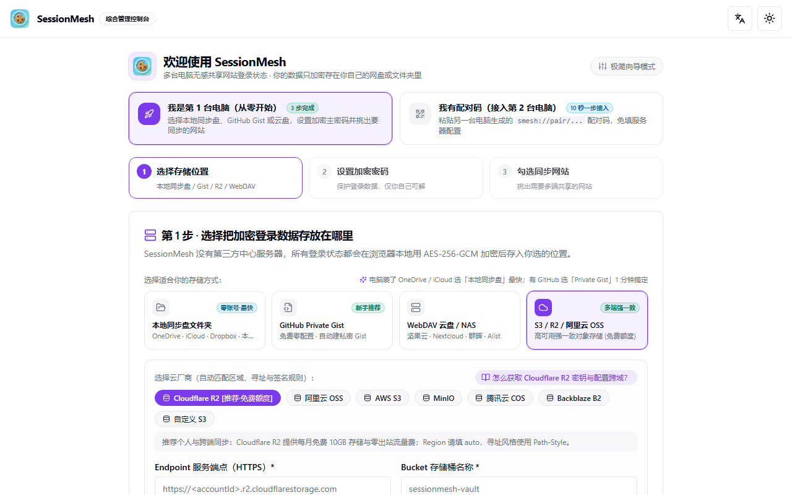
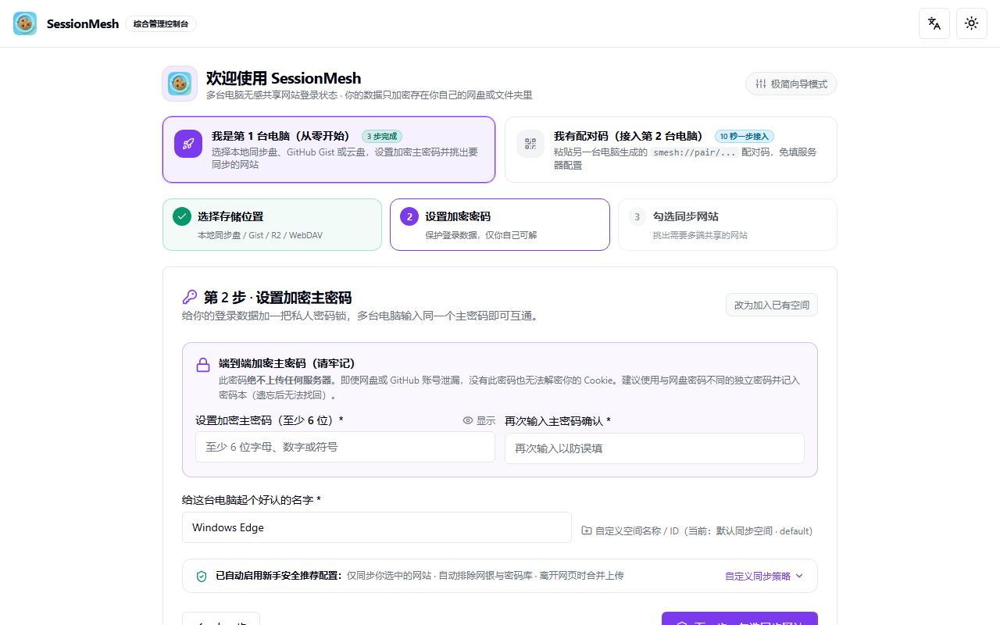
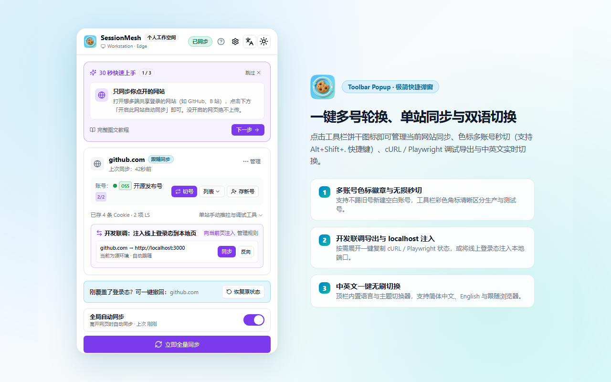
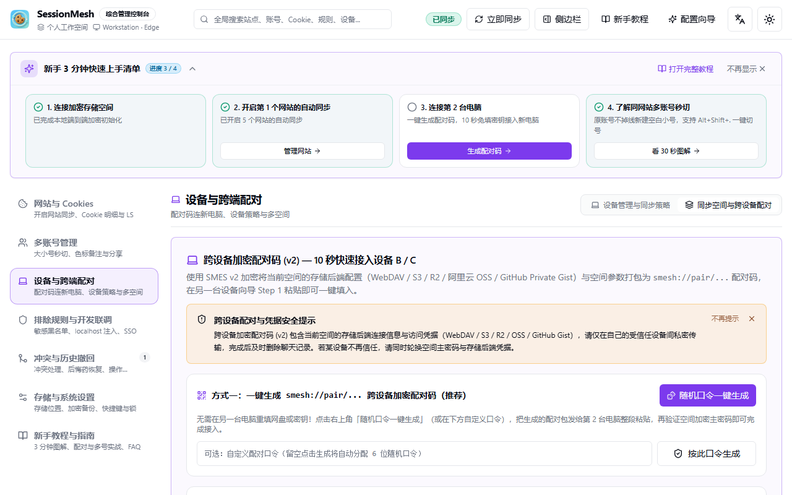
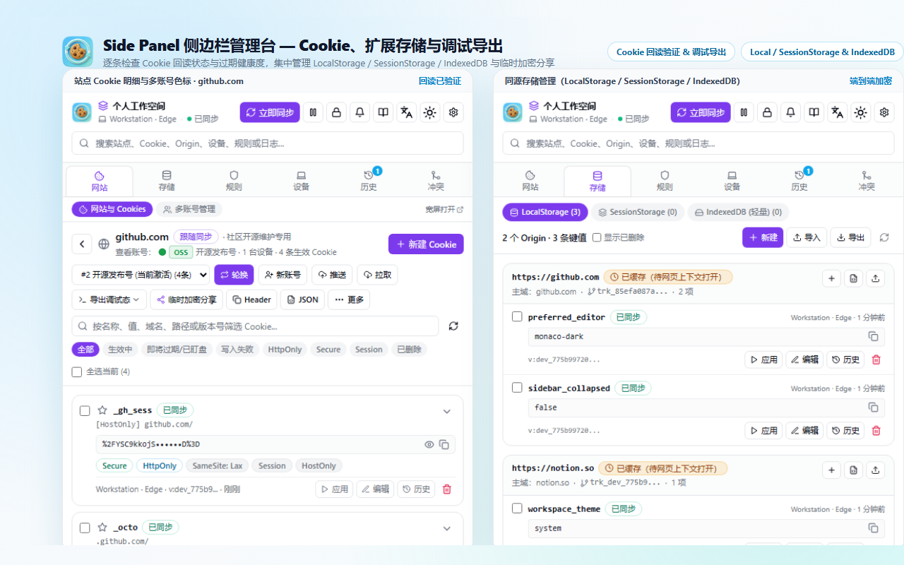
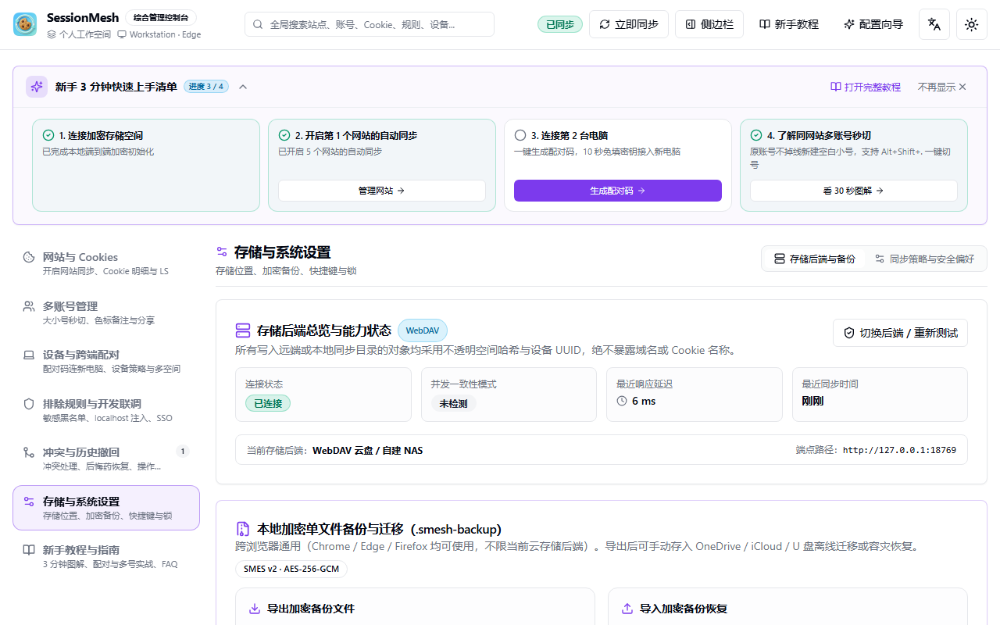
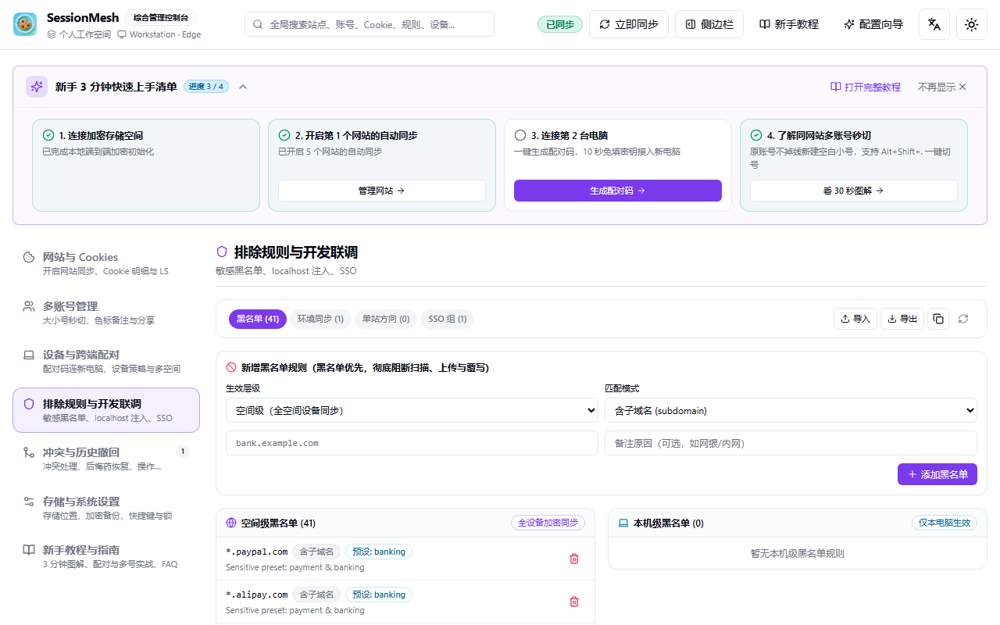
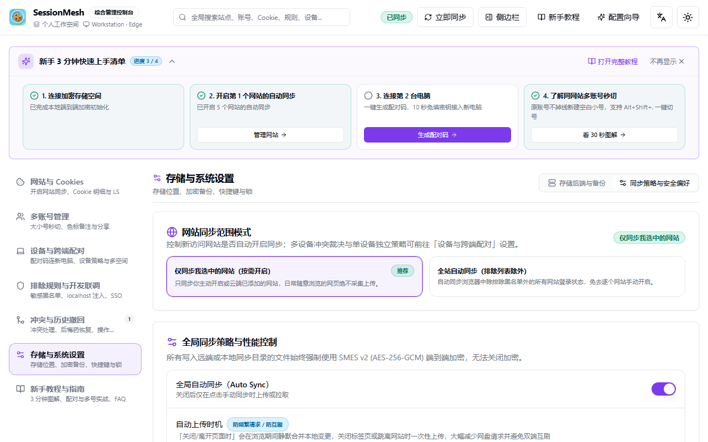

<div align="center">
  
  <h1>SessionMesh</h1>
  <p>基于自选多存储后端（WebDAV / S3 / R2 / 阿里云 OSS / GitHub Private Gist / 本地同步盘）与客户端端到端加密的多设备浏览器登录态自动同步扩展。</p>

  <p>
    <a href="https://microsoftedge.microsoft.com/addons/detail/lciamlghddinjagggaocchcoifncbnak">
      
    </a>
    <a href="https://github.com/fxwl/screenshots/actions/workflows/build-zip.yml">
      
    </a>
    
    
    
    
    
  </p>

  <p><a href="./README.md">English</a> | <strong>简体中文</strong></p>
</div>

---

**SessionMesh** 是一款面向 **Microsoft Edge**（同时兼容各类 Chromium 内核浏览器与 Firefox 构建）的开源扩展，通过**你自己的存储后端**（WebDAV、S3 / Cloudflare R2 / 阿里云 OSS / MinIO、GitHub Private Gist 或 OneDrive / iCloud / Dropbox 本地同步目录）在多台设备间自动同步网站登录状态（**Cookie**、同源 **`localStorage`**、**`sessionStorage`** 与按站启用的 **`IndexedDB`**）。所有数据在离开浏览器前均在本地完成端到端加密，无开发者后端、无统计追踪。

## 核心特性

- **零知识端到端加密（SMES v2）**：全部数据在本地通过 Web Crypto API 加密（`AES-256-GCM` 认证加密 + 文件头/路径 AAD 绑定、`PBKDF2-SHA256` 200,000 次迭代派生主密钥、单文件 `HKDF-SHA256` 独立密钥）。
- **本地密钥安全封装**：主加密密码永不以明文落盘；空间密钥通过不可导出（`extractable: false`）的本地 `AES-256-GCM` 密钥封装存储，支持开启**会话锁定（Session Lock）**模式，关闭浏览器自动清空密钥。
- **多存储后端与通用 `.smesh-backup` 单文件加密备份**：
  - **WebDAV**：兼容坚果云、Nextcloud、群晖 NAS、Alist、Caddy、Nginx 等任意标准 WebDAV 服务，内置 **19 项能力与强一致 CAS 探测**及 HTTP `507` 熔断保护。
  - **S3 / Cloudflare R2 / 阿里云 OSS / MinIO / 腾讯云 COS / Backblaze B2**：零外部依赖实现 AWS SigV4 与阿里云 `oss_v4` 签名，支持厂商预设与 Path / Virtual-Hosted 寻址风格。
  - **GitHub Private Gist**：零成本私有同步，严格校验 `public === false` 强制拦截公开 Gist。
  - **本地同步盘文件夹**：通过 Chromium File System Access API 与 IndexedDB 句柄持久化直接读写 **OneDrive / iCloud / Dropbox / 本地目录**，支持一键恢复目录读写授权。
  - **本地单文件加密备份（`.smesh-backup`）**：全浏览器通用（Chrome / Edge / Firefox），支持**因果智能合并（`merge`）**与**全量覆盖恢复（`replace`）**。
- **扩展存储同步（`sessionStorage` 与按站启用 `IndexedDB`）**：支持全局默认 + 单站覆盖 `sessionStorage` 同步（含键名白名单），以及单站按需开启 `IndexedDB` 精确库表快照同步与字节上限配额保护。
- **按需纳管、主基准设备与双层黑名单**：默认仅同步你主动纳入管理的网站（`managed_only`），支持空间统一基准策略（`ask` / `primary_device` / `latest_wins`）与单设备独立策略（只读跟随、仅上传、独立轨道、设备专属排除），并配备空间级 + 本机级双层黑名单与 SSO 关联域名分组。
- **智能同步时机与高可靠同步内核**：默认支持**离开页面时上传（`on_page_leave`）**（页面打开期间静默合并变更，离开时自动批量落盘）与实时/定时同步；内置同名/同路径碰撞 Cookie 精确消歧、强制浏览器回读验证、异常退出启动补齐与 `>256KB` 超大 SPA `localStorage` 跳过保护。
- **多账号色标徽标与全局快捷键**：同一网站支持无损新建空白账号、自定义账号颜色与 `<=4` 字角标简称（支持 `multi_or_tagged` / `always` / `status_only` 显示模式），并支持 `chrome.commands` 全局快捷键（`Alt+Shift+.` / `Alt+Shift+,` 轮换账号、`Alt+Shift+S` 同步当前站、`Alt+Shift+C` 复制 cURL）。
- **团队临时加密分享与开发者调试导出**：支持生成带有效期限制的 `smesh://share/v1.` 团队临时加密分享（导入前预览、有效期截断、`HttpOnly` 与名称过滤、临时轨道/开发映射/覆盖三种导入模式），并支持一键导出为 `cURL`、`fetch`、`Cookie` 请求头、`headers.json`、Playwright `storageState.json`、Postman/Apifox JSON 与 Netscape `cookies.txt`。
- **Cookie 登录态过期预警**：自动监测认证 Cookie 与加星标关注 Cookie 的剩余有效期（支持同时监控非激活备用账号与自定义预警/危急小时阈值），在弹窗、侧边栏与角标提前预警。
- **开发与生产环境 Cookie 数据同步**：支持将线上生产/预发环境的登录态 Cookie、`localStorage` 与 `sessionStorage` 一键或实时自动映射同步至 `localhost` / `127.0.0.1` / 本地开发域名，自动重写 `Domain` 并适配 HTTP 环境下的 `Secure` 与 `SameSite` 属性，支持绑定指定账号轨道或随多账号轮换联动更新。
- **安全自动刷新守卫与防死循环护盾**：准备刷新标签页前自动检测未保存表单、活跃输入、富文本编辑或待上传文件，并屏蔽仅 `localStorage` 变更或后台轮询导致的刷新死循环。
- **侧边栏与完整控制台**：支持逐条查看/编辑/导入导出 Cookie（含回读验证状态）、`localStorage`、`sessionStorage` 与 `IndexedDB`，冲突处理、历史回滚、存储 AEAD 完整性校验、备份恢复与安全垃圾回收（GC）。
- **完整中英文双语切换（`简体中文` / `English` / `跟随浏览器`）**：支持在向导、Popup、侧边栏、控制中心、右键菜单与工具栏提示中一键无刷实时切换中英文界面。

## 安装方式

### 商店安装与自动编译发布包（推荐）

- **Microsoft Edge Add-ons**：[前往 Microsoft Edge 外接程序商店一键安装](https://microsoftedge.microsoft.com/addons/detail/lciamlghddinjagggaocchcoifncbnak)
- **GitHub Releases（每次推送自动编译双端包）**：[前往 Releases 下载最新版本](https://github.com/fxwl/screenshots/releases)，同时提供 Chromium / Edge 通用 `sessionmesh-v*.zip`（解压后在 `edge://extensions` 或 `chrome://extensions` 加载）以及 Firefox 115+ 专用 `sessionmesh-firefox-v*.xpi`（内置原生 Firefox 侧边栏支持）。

### 从源码构建

环境要求：**Node.js >= 20.12**、**pnpm 9+**。

```bash
# 1. 安装依赖
pnpm install

# 2. 构建扩展产物（输出到 dist/）
pnpm build

# 3. （可选）打包商店上传用 ZIP（输出到 dist-zip/）
pnpm zip
```

在 Microsoft Edge（或其他 Chromium 内核浏览器）中加载本地扩展：

1. 打开 `edge://extensions`。
2. 开启**开发人员模式**。
3. 点击**加载解压缩的扩展**，选择项目根目录下的 `dist/` 文件夹。

## 快速上手

> 📘 **零基础新手？** 推荐直接阅读 **[《SessionMesh 零基础 3 分钟保姆级上手教程》](./docs/GETTING_STARTED_ZH.md)**（含存储方式选择对比、免输密钥本地盘/GitHub 一键生成 Token 小抄、多账号防掉线切换与常见问题自检），或在扩展控制中心左侧打开内置的 **「新手教程与指南」** 专区。

### 第 1 步：选择存储位置（首台电脑极速 3 步 / 配对码一步直通）

首次安装会自动打开极简配置向导：
- **首台电脑初始化**：自由选择 **本地同步盘文件夹**（OneDrive / iCloud / Dropbox，免填任何账号密钥）、**GitHub Private Gist**（内置一键预填 `gist` 权限生成 Token 入口）、**Cloudflare R2 / 阿里云 OSS**（内置一键复制 CORS 跨域 JSON）或 **WebDAV**（坚果云 / Nextcloud / 群晖 NAS）。低频工程参数默认自动折叠，点击下一步即自动完成连通性与空间探测。
- **第 2 台电脑接入**：首屏直接切换至 **「我有配对码」**，整段粘贴配对包即可自动提取口令并一步完成验证接入。

<p align="center">
  
</p>

### 第 2 步：设置端到端加密主密码

设置一个独立的**端到端加密主密码**（永不上传任何服务器），向导已默认启用新手推荐安全配置（仅同步选中网站 + 自动排除网银与密码库 + 离开网页时静默合并上传；进阶用户可随时开启「专家模式」微调策略）。

<p align="center">
  
</p>

### 第 3 步：勾选同步网站，日常通过简洁 Popup 秒切操作

在向导第 3 步勾选本机已登录网站即可开始自动加密同步（完成页亦可顺手一键生成第 2 台电脑配对码）。日常点击工具栏图标默认展示清爽的**简洁视图**（一键开启/停止当前站同步、新建空白小号、`Alt+Shift+.` 切号、一键撤回覆盖），并内置首次使用 30 秒引导卡片；需要调试导出（`cURL` / Playwright / Postman）或跨环境注入时可按需展开开发者工具。

<p align="center">
  
</p>

### 跨设备配对：随机口令一键生成，10 秒接入新电脑

打开 **控制中心 → 设备与跨端配对 → 跨设备配对**（或点击 Popup 底部 **「连新电脑」**），点击**「随机口令一键生成」**并复制完整配对包，在另一台设备的向导中整段粘贴即可自动识别口令并完成配对。

<p align="center">
  
</p>

## 界面总览

### 侧边栏管理台 — Cookie 回读验证、扩展存储与调试导出

实时查看每条 Cookie 的 `HttpOnly` / `Secure` / `SameSite` 属性、过期健康预警与**回读已验证**状态，支持多账号色标切换、多种格式调试导出，以及按 Origin 隔离管理 `localStorage`、`sessionStorage` 与按站启用的 `IndexedDB` 记录。

<p align="center">
  
</p>

### 控制中心 — 多存储后端、`.smesh-backup` 本地加密备份与维护

直观查看当前存储后端（`WebDAV` / `S3 · R2 · OSS` / `GitHub Private Gist` / `本地同步文件夹`）连接状态与一致性模式，支持一键恢复本地文件夹读写授权、跨浏览器导入导出 `.smesh-backup` 单文件加密归档、AEAD 完整性校验、加密快照与历史垃圾回收（GC）。

<p align="center">
  
</p>

### 控制中心 — 同步规则与双层黑名单

支持配置空间级（全设备同步）与本机级双层黑名单（优先级高于任何同步规则）、单站 `sessionStorage`/`IndexedDB` 覆盖规则、敏感站点预设过滤、SSO 域名组与规则 JSON 导入导出。

<p align="center">
  
</p>

### 控制中心 — 同步策略、快捷键、工具栏角标与过期预警

自由切换「仅同步已纳管网站 / 全站自动纳管」，配置 `sessionStorage` 全局开关、工具栏账号角标显示模式（`multi_or_tagged` / `always` / `status_only`）、Cookie 登录态过期预警提前小时数，并查看/跳转修改 `chrome.commands` 全局快捷键。

<p align="center">
  
</p>

## 常见问题与测试排错

以下整理了实际联调与多 WebDAV / Chromium MV3 测试中常见的问题与内置保护机制：

- **提示「禁止不安全的 `http://` 地址，必须使用 HTTPS」**
  - 线上 WebDAV 服务出于安全要求强制使用 `https://`。
  - 如使用内置本地测试服务 `node scripts/start-local-webdav.mjs`（`http://127.0.0.1:8765`），需在向导第 1 步输入 `127.0.0.1` / `localhost` 后，开启下方出现的**「允许本机回环 HTTP 调试」**开关。
- **坚果云（Nutstore）或 Nextcloud 连接报 `401 Unauthorized`**
  - 请勿直接填写网页登录密码。坚果云与开启两步验证的 Nextcloud 必须在后台安全设置中生成**应用专用密码（App Password）**，并在认证方式中选择对应模式。
- **测试连接时 `OPTIONS` 请求返回 `403` / `405` / `501`**
  - Cloudflare WAF、IIS、群晖反向代理或坚果云等环境常禁用 `OPTIONS` 探测，但 `PROPFIND` / `PUT` / `GET` 实际正常。SessionMesh 的 19 项探测会自动降级改用 `PROPFIND` 验证连通性，可在 **WebDAV 存储与维护** 中展开 19 项报告查看详情。
- **检测到「仅追加降级模式」而非「强一致 CAS」**
  - 部分轻量 WebDAV 服务端会忽略 `If-Match` / `ETag` 条件更新头。SessionMesh 会在探测阶段主动识别并自动切换为安全的仅追加模式，避免静默覆盖冲突；可定期在维护页执行「生成加密快照」与「安全清理历史（GC）」。
- **WebDAV 返回 `507 Insufficient Storage`（远端空间已满）**
  - 扩展会自动触发 `storageFullHalted` 熔断停止后台无效重试。释放网盘空间或执行历史 GC 后，在面板点击一次**立即同步**即可自动解除熔断并恢复同步。
- **`localStorage` 显示「已缓存（待网页上下文打开）」或跳过超大键值**
  - 受浏览器安全模型限制，扩展只能在对应网站标签页打开时读写其同源 `window.localStorage`；远端拉取的键值会先缓存在本地，下次打开该网站时自动注入生效。单条超过 `256KB` 的大型 SPA 缓存会被自动跳过，同时安全处理 `__proto__` / `constructor` 等保留键名。
- **特殊前缀与同名碰撞 Cookie（`__Host-` / `__Secure-` / `SameSite=None` / `hostOnly` 与 `.domain`）**
  - Chromium 对前缀 Cookie 校验极严，且同一名称下可能同时存在 `hostOnly`、泛域名 `.domain` 或不同路径（`/admin` 与 `/`）的碰撞 Cookie。SessionMesh 已统一归一化默认存储区（`"0"` / `"firefox-default"` → `"default"`），在回读和删除时精确消歧避免误删兄弟 Cookie，并在旧浏览器不支持 `partitionKey`（CHIPS）时自动回退；若单条仍写入失败，可在侧边栏筛选「写入失败」查看原因并一键重试。
- **网页仍打开时修改了登录态但尚未立即上传**
  - 默认采用**离开页面时上传（`on_page_leave`）**模式：标签页打开期间会在本地静默合并频繁变更，切换或关闭页面时自动批量加密上传，也可随时点击**立即同步**。如需即时上传，可在 **控制中心 → 同步策略与高级设置** 中切换为实时模式。
- **拉取登录态后页面没有自动刷新**
  - 多层**安全刷新守卫**与防死循环护盾会在检测到表单未保存输入、15 秒内活跃打字、`contenteditable` 富文本修改或 `<input type="file">` 待上传文件时主动延后刷新，且不会对仅 `localStorage` 变更触发死循环刷新；编辑完成后手动刷新即可。
- **重启浏览器后提示锁定 / 忘记端到端主密码**
  - 开启**会话锁定（Session Lock）**后，本地封装密钥仅存于 `chrome.storage.session`，关闭浏览器自动清除，重新输入主密码即可解锁恢复。由于采用零知识加密，遗忘主密码无法找回，需在已解锁设备上轮换密码或重建新空间。

## 开发指南

```bash
pnpm dev            # 启动开发监听模式
pnpm lint           # 全工作区 ESLint + Prettier 检查
pnpm type-check     # 全工作区 TypeScript 类型检查
pnpm test           # 运行 Vitest 单元测试与验收测试集
pnpm clean          # 安全清理 dist/ 与 .turbo 缓存
pnpm build          # 生产构建 -> dist/
pnpm build:firefox  # Firefox MV3 生产构建 -> dist/
pnpm zip            # 生产构建并打包 Chromium/Edge 压缩包 -> dist-zip/
pnpm zip:firefox    # Firefox MV3 构建并打包 .xpi 扩展包 -> dist-zip/
```

如需在不依赖外部服务器的情况下本地联调 WebDAV，可直接启动内置测试服务：

```bash
node scripts/start-local-webdav.mjs
```

贡献流程请查看 [CONTRIBUTING.md](./CONTRIBUTING.md)，版本变更记录请查看 [CHANGELOG.md](./CHANGELOG.md)。

## 项目结构

```text
.
├── chrome-extension/     # MV3 清单、后台 Service Worker、多语言包与图标
├── pages/
│   ├── popup/            # 工具栏弹窗（状态总览、多账号切换、分享与调试导出）
│   ├── sidepanel/        # 侧边栏管理台（站点轨道、Cookie、local/sessionStorage 与 IndexedDB）
│   ├── options/          # 完整控制中心（多存储后端、.smesh-backup 备份、规则、快捷键与策略）
│   └── content/          # 内容脚本（存储监听、切号悬浮提示与安全刷新守卫）
├── packages/
│   ├── core/             # 核心同步引擎、SMES v2 加密、WebDAV/S3/Gist/本地目录适配器、调试导出与过期预警
│   ├── storage/          # IndexedDB 持久化、DirHandleStore、不可导出密钥库与 chrome.storage 封装
│   ├── shared/           # 跨进程 IPC 协议、React Hooks 与通用工具
│   ├── ui/               # 公共 Tailwind / Radix UI 组件库
│   ├── webdav-mock/      # 用于自动化与本地测试的内存 WebDAV 服务
│   ├── zipper/           # 发布包打包工具（dist/ -> dist-zip/）
│   └── ...               # 构建与开发工具（hmr、dev-utils、tsconfig、tailwind-config）
├── docs/screenshots/     # 项目与商店实机截图（1280×800 24 位 PNG）
└── scripts/              # 本地开发辅助脚本
```

## 隐私与安全

SessionMesh 仅在你的浏览器与你自行配置的存储后端（WebDAV、S3/R2/OSS、GitHub Private Gist 或本地同步目录）之间直连通信，不收集任何个人数据，不含统计/遥测代码，不执行远程代码。

- 隐私政策与权限用途说明：[PRIVACY.md](./PRIVACY.md)
- 安全架构与漏洞反馈指南：[SECURITY.md](./SECURITY.md)

## 开源协议

本项目基于 [MIT](./LICENSE) 协议开源。
