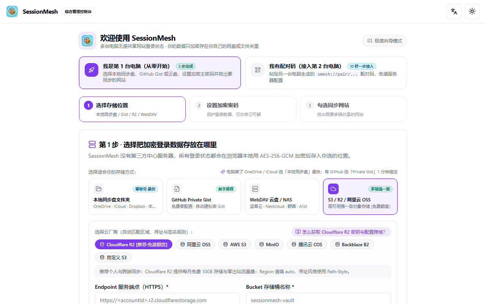
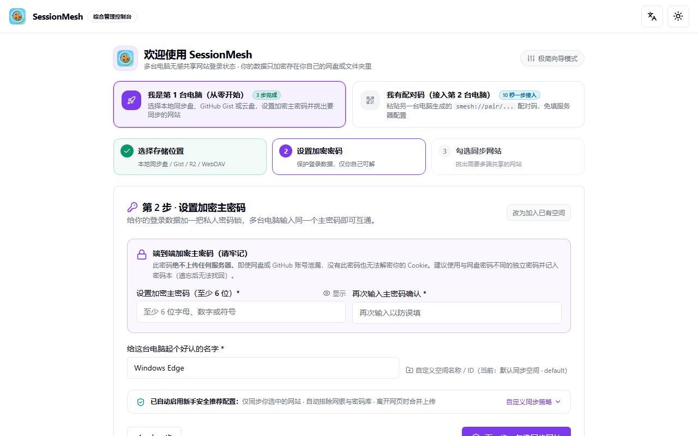
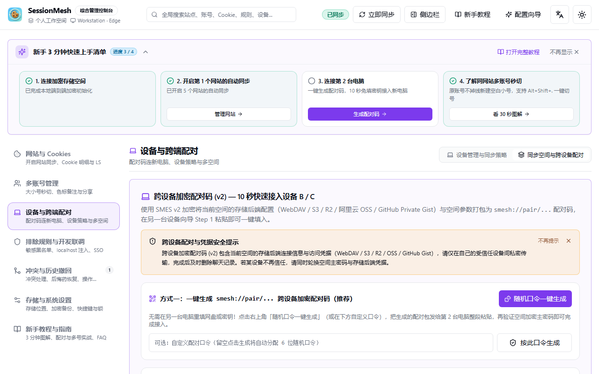
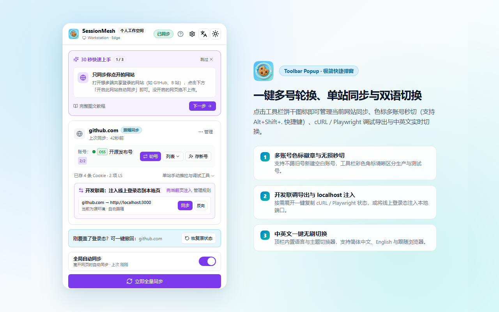

# SessionMesh 零基础 3 分钟保姆级上手教程

欢迎使用 **SessionMesh**！本教程专为第一次接触多设备登录同步的新手编写，不讲复杂加密术语，手把手带你在 **3 分钟内让两台电脑共享网站登录状态**。

---

## 一、先花 20 秒了解：它是怎么安全工作的？

平时你在公司电脑和家里电脑都要反复扫码登录同一批网站（如 GitHub、B 站、知乎、内部后台）。SessionMesh 帮你把登录状态安全同步过去：

1. **只同步你点开的网站**：日常随便逛的网页默认不上传，网银、支付与密码库默认自动排除。
2. **没有第三方中心服务器**：扩展先在你的浏览器本地用你设置的**加密主密码**把登录数据锁成密文，再存进**你自己的云盘 / 文件夹**。哪怕网盘账号被盗，别人没有你的主密码也解不开。
3. **关闭网页时安静上传**：你在浏览网页时它不会每秒狂刷网盘，而是在你关闭标签页或跳离网站时自动打包上传。

---

## 二、第 1 台电脑初始化（极速 3 步）

安装扩展后会自动弹出配置向导（没弹出可点击浏览器右上角拼图图标 → **SessionMesh** → **开始 3 步快速配置**）。

### 第 1 步：选一种最适合你的存储方式

不知道选哪个？对照下表直接挑最省事的一种即可：

| 存储方式 | 上手难度 | 适合谁？ | 怎么填？ |
| :--- | :--- | :--- | :--- |
| **本地同步盘文件夹** | ⭐ 零账号密钥（最快） | 电脑上已经装了 **OneDrive / iCloud Drive / Dropbox** 客户端的用户 | 点击「选择同步文件夹」，在你的同步盘里新建或选一个文件夹并允许读写，**无需填任何账号密码**！ |
| **GitHub Private Gist** | ⭐ 1 分钟搞定（免费） | 有 GitHub 账号的用户 | 点击表单上的**「一键前往 GitHub 生成 Token」**（已自动只勾选 `gist` 权限）→ 滑到底部点 `Generate token` → 复制 `ghp_...` 粘贴回来即可（系统会自动建私密 Gist）。 |
| **WebDAV（坚果云 / NAS）** | ⭐⭐ 国内直连 | 坚果云、Nextcloud、群晖 NAS、Alist 用户 | **坚果云注意**：先点表单上的「坚果云」预设按钮；密码**不能填登录密码**，需在坚果云网页版【账户信息 → 安全选项 → 第三方应用管理】生成一个**应用密码**填入。 |
| **S3 对象存储（Cloudflare R2 / OSS）** | ⭐⭐ 多端强一致推荐 | 有 Cloudflare 账号（每月 10GB 免费）或阿里云 OSS 用户 | 选 `Cloudflare R2` 预设 → 填入存储桶名（Bucket）、S3 Endpoint、Access Key ID 与 Secret Access Key 即可（区域与签名已自动配好）。 |

填好后直接点击右下角 **「下一步：设置加密密码」**，系统会自动帮你测试连接。

  

### 第 2 步：设置你的「加密主密码」

1. 输入一个至少 6 位的**端到端加密主密码**并确认（建议与网盘密码不同，并记在备忘录里——所有电脑接入时都要用这同一个主密码）。
2. 给当前电脑留个好认的名字（比如 `公司台式机` 或 `MacBook`）。
3. 页面已自动为你开启新手最佳安全配置（仅同步选中网站 + 自动排除网银密码库 + 离开页面合并上传），直接点击 **「下一步：勾选同步网站」**。

  

### 第 3 步：勾选你想多端共享的网站

1. 在扫描出的已登录网站列表中，勾选你常看的网站（例如 `github.com`、`bilibili.com`）。
2. 如果你手头正好有第 2 台电脑，可以顺手点开页面下方的 **「想顺便连上第 2 台电脑？一键生成跨设备配对码」**，点一次生成并复制完整配对包。
3. 点击右下角 **「完成配置，开始使用」**（勾选的网站会自动保存并开始加密同步！）。

> 💡 **强烈建议**：点击浏览器地址栏右侧的「拼图图标 🧩」，把 **SessionMesh 固定（Pin）在工具栏**，以后点一下就能开关网站同步或切换大小号！

---

## 三、10 秒连入第 2 台电脑（免重填服务器密钥）

千万不要在第 2 台电脑重新手动敲一遍长长的服务器地址和 Token！用**配对码**只需 10 秒：

1. **在第 1 台电脑复制配对包**：
   - 点击扩展弹窗底部的 **「连新电脑」**（或打开 `控制中心 → 设备与跨端配对 → 跨设备配对`）。
   - 点击 **「随机口令一键生成」** → 点击 **「复制完整配对包（含口令）」**，通过微信文件传输助手或私密备忘录发给第 2 台电脑。
2. **在第 2 台电脑一键粘贴接入**：
   - 安装扩展后，在欢迎界面点击 **「我有配对码（接入第 2 台电脑）」**。
   - 把刚才复制的整段文字直接粘贴进输入框（系统会自动提取 `smesh://pair/...` 配对码和 6 位随机口令！）→ 点击 **「解析配对码」**。
   - 输入第 1 台电脑设置的**加密主密码**，点击 **「一键验证并完成接入」** 即可！

  

> 📌 **注**：如果你第 1 台电脑选的是「本地同步盘文件夹」，第 2 台电脑解析配对码后只需点一下按钮选中本机对应的 OneDrive / iCloud 同步文件夹即可互通。接入完成后别忘了顺手删掉聊天记录里的配对消息。

---

## 四、日常最常用的 3 个神仙操作

### 1. 随时开启或关闭某个网站的同步
打开任意网站，点击右上角 **SessionMesh 图标**：
- 显示 `未开启同步` 时：点一下蓝色按钮 **「开启 xxx 多端自动同步」** 即可。
- 不想再同步某网站时：点击卡片右上角 **「管理 → 停止在本机同步此网站」**（或「加入排除列表」）。

  

### 2. 同一网站同时挂多个账号并秒切（原账号不掉线！）
平时在网页里点「退出登录」去登小号，会导致大号的登录凭证被服务器直接注销！用 SessionMesh 可以无损双开/多开：
1. 先正常登录第 1 个账号（大号）。
2. 点击扩展图标 → **「+ 存新号」** → 选择 **「新建空白小号（清空当前页去登新号）」**，输入名字（如 `测试小号`）回车。
3. 此时大号已被完好封存，网页会自动变成未登录状态——直接在网页上登录你的第 2 个号即可！
4. 以后想切号时：直接按键盘快捷键 **`Alt + Shift + .`**（或在弹窗点 **「切号」**），1 秒来回切换！还可以在「多账号管理」里给生产号标红色、测试号标橙色，一眼看清角标防误操作。

### 3. 前端开发：把线上登录态一键带到 `localhost` 调试
本地起前端项目（如 `http://localhost:5173`）需要线上登录 Cookie 时：
1. 先在浏览器登录好线上或预发环境域名。
2. 切回 `localhost` 标签页，点击右上角 **SessionMesh 图标**，弹窗会自动展示 **「开发联调：注入线上登录态到本地页」** 面板。
3. 选好源网站点 **「注入并自动同步」**，扩展会自动改写 `Domain` 并适配 HTTP 下的 `Secure` / `SameSite` 属性！

---

## 五、新手常见疑问解答（FAQ）

1. **为什么我在网页刚登录完，另一台电脑还没马上收到？**
   - 默认启用了「离开页面时自动上传」：当你**关闭该网页标签、跳转到别的网站**，或者打开扩展点一次 **「立即全量同步」** 时就会立刻上传。如果你希望每次变动都秒传，可在 `控制中心 → 存储与系统设置 → 同步策略` 将上传时机改为「实时上传」。
2. **为什么另一台电脑同步了新 Cookie，我当前打开的网页没自动刷新？**
   - 为了防止你正在网页里写文章或填表单时突然刷新丢字，后台默认「静默写入 Cookie」，你手动按 `F5` 刷新一下页面就生效了。
3. **不小心选错了云端版本把我本机刚登的号覆盖了怎么办？**
   - 别慌！每次覆盖或切换账号前，SessionMesh 都会在本地自动留存一份**后悔药恢复点**。打开扩展弹窗直接点黄色/蓝色提示条上的 **「恢复原状态」**（或去侧边栏「历史与后悔药」）就能一键还原。
4. **在哪里可以重新打开本教程或新手清单？**
   - 点击扩展弹窗右下角的 **「新手教程」** 按钮，或在控制中心左侧菜单点击 **「新手教程与指南」** 即可随时查看交互式图解。
